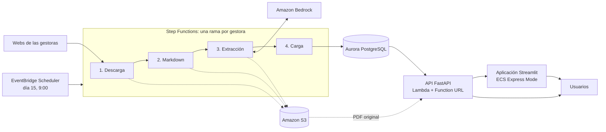
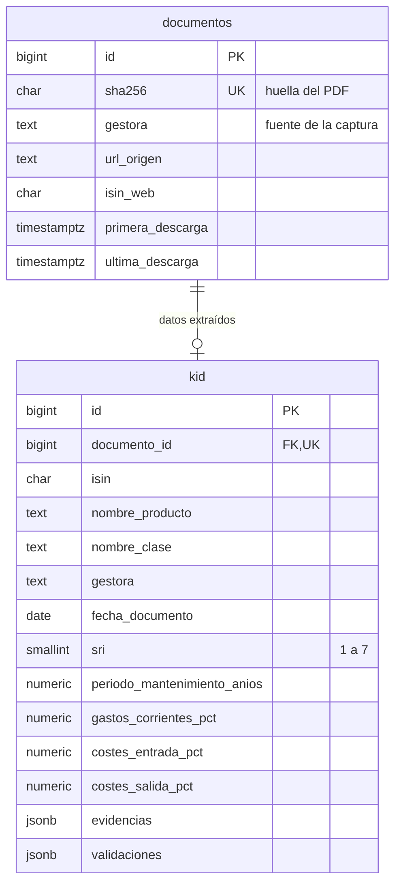
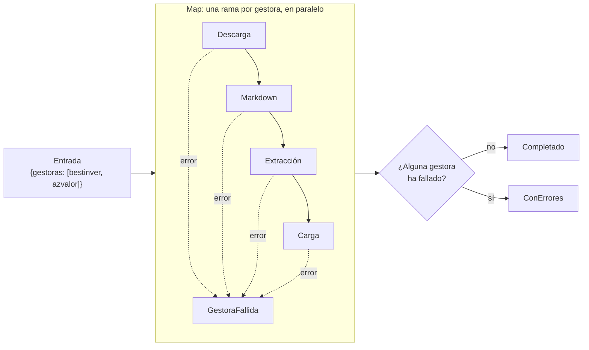
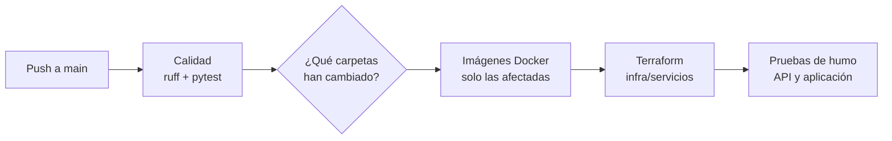

# pipeline-kid-fondos

Pipeline de datos de fondos de inversión en AWS: captura de los KID (Documento de Datos Fundamentales) publicados por las gestoras, extracción de sus datos con IA generativa en Amazon Bedrock, carga en PostgreSQL y explotación mediante una API y una aplicación web.

Toda la infraestructura se define con Terraform y se despliega desde GitHub Actions. El pipeline se ejecuta solo cada mes.

| | URL |
|---|---|
| Aplicación web | https://pi-6c9cfc374be7431f8c3058120831ea50.ecs.eu-west-3.on.aws |
| API (documentación interactiva) | https://tnijl3yhrqcf5wordj6kebujmy0ismsu.lambda-url.eu-west-3.on.aws/docs |

## Contenido

- [Qué hace](#qué-hace)
- [Arquitectura](#arquitectura)
- [Decisiones de diseño](#decisiones-de-diseño)
- [Captura de los KID (etapa 1)](#captura-de-los-kid-etapa-1)
- [Extracción de los datos (etapas 2 y 3)](#extracción-de-los-datos-etapas-2-y-3)
- [Base de datos (etapa 4)](#base-de-datos-etapa-4)
- [Orquestación y ejecución programada](#orquestación-y-ejecución-programada)
- [API](#api)
- [Aplicación web](#aplicación-web)
- [Integración y despliegue continuos](#integración-y-despliegue-continuos)
- [Seguridad](#seguridad)
- [Calidad y pruebas](#calidad-y-pruebas)
- [Costes de funcionamiento](#costes-de-funcionamiento)
- [Despliegue desde cero](#despliegue-desde-cero)
- [Desarrollo en local](#desarrollo-en-local)
- [Limitaciones y posibles mejoras](#limitaciones-y-posibles-mejoras)
- [Estructura del repositorio](#estructura-del-repositorio)

## Qué hace

Cada mes, el pipeline visita las webs de **Bestinver** y **Azvalor**, descarga el KID de cada uno de sus fondos y extrae con un modelo de lenguaje los datos que un inversor necesita para comparar fondos: el indicador de riesgo, el periodo de mantenimiento recomendado y los costes. Cada dato se guarda junto a la frase del documento de la que sale y se contrasta antes de cargarlo en la base de datos. La API y la aplicación web ponen esos datos a disposición de cualquier usuario.

Campos que se extraen de cada KID (Anexo A del enunciado):

| Campo | Descripción |
|---|---|
| `isin` | Código ISIN del fondo o de la clase |
| `nombre_producto`, `nombre_clase` | Nombre del fondo y, si la hay, de la clase |
| `gestora` | Productor del PRIIP según el documento |
| `fecha_documento` | Fecha de elaboración del KID |
| `sri` | Indicador resumido de riesgo, de 1 a 7 |
| `periodo_mantenimiento_anios` | Periodo de mantenimiento recomendado, en años |
| `gastos_corrientes_pct` | Gastos corrientes anuales, en % |
| `costes_entrada_pct`, `costes_salida_pct` | Comisiones de entrada y de salida, en % |

**Resultados de la ejecución del 27/11/2026:**

| | Bestinver | Azvalor | Total |
|---|---|---|---|
| KID capturados, extraídos y cargados | 22 | 5 | 27 |
| SRI medio | 3,05 | 4,20 | |
| Gastos corrientes medios | 1,28 % | 1,72 % | |

| Control de calidad | Resultado |
|---|---|
| ISIN con dígito de control correcto | 27 de 27 |
| ISIN igual al publicado en la web de la gestora | 21 de 21 comparables (6 fichas no publican un ISIN único) |
| SRI dentro de la escala de 1 a 7 | 27 de 27 |
| Evidencias encontradas literalmente en el documento | 247 de 251 |
| Duración del pipeline completo (dos gestoras en paralelo) | unos 5 minutos |
| Segunda ejecución sobre los mismos documentos | 0 filas nuevas (27 documentos, 27 KID) |

## Arquitectura



| Capa | Servicio | Papel |
|---|---|---|
| Captura | Lambda (requests + lxml) | Descarga los KID de Bestinver y Azvalor y registra su origen en un manifiesto |
| Almacenamiento | Amazon S3 | PDF, Markdown y JSON extraídos, por gestora y fecha |
| Conversión | Lambda (pymupdf4llm + RapidOCR) | Convierte cada PDF a Markdown, con OCR donde hace falta |
| Extracción | Lambda + Amazon Bedrock | Extrae los campos con salida estructurada (JSON Schema) y los contrasta |
| Base de datos | Aurora PostgreSQL Serverless v2 + RDS Data API | Datos de cada KID, sin duplicados y con histórico |
| Orquestación | Step Functions + EventBridge Scheduler | Encadena las etapas y las ejecuta cada mes |
| API | FastAPI en Lambda (Function URL) | Única vía de acceso a los datos |
| Aplicación | Streamlit en ECS Express Mode | Exploración visual y comparación de fondos |
| Despliegue | Terraform + GitHub Actions (OIDC) | Infraestructura como código, sin credenciales guardadas |

**Recorrido de un KID.** El día 15 de cada mes, EventBridge Scheduler inicia la máquina de estados con la lista de gestoras. Para cada una, la etapa de descarga localiza los KID en su web, guarda los PDF en S3 con un manifiesto de origen y pasa la lista de ficheros a la siguiente etapa. La conversión deja el Markdown de cada PDF en S3. La extracción envía cada Markdown a Bedrock, comprueba la respuesta y guarda un JSON con los datos, las evidencias y los controles. La carga inserta esos JSON en PostgreSQL sin duplicar documentos. A partir de ese momento, la API sirve los datos nuevos y la aplicación los muestra.

## Decisiones de diseño

**Pipeline en cuatro etapas encadenadas.** Descarga, conversión a Markdown, extracción y carga son funciones Lambda independientes (imágenes Docker) que Step Functions ejecuta en serie para cada gestora. Cada etapa deja su resultado en S3 y devuelve la lista de ficheros que la siguiente debe procesar. Frente a una única función que lo hiciera todo, permite repetir solo la etapa que falla, mantiene imágenes ligeras (el OCR y el cliente del modelo no conviven) y deja registro de cada ejecución.

**Fuentes y alcance.** Bestinver y Azvalor, solo documentos KID. Se extraen los campos del Anexo A del enunciado. Añadir una gestora consiste en escribir su módulo de captura (ver [Limitaciones y posibles mejoras](#limitaciones-y-posibles-mejoras)).

**Trazabilidad de la captura.** Cada ejecución guarda un `manifiesto.json` con, por documento: URL de origen, fecha y hora de descarga (UTC), huella `sha256` y tamaño. La huella identifica un mismo PDF aunque se descargue varias veces.

**Extracción con salida estructurada.** El modelo (Kimi K3.1 en Bedrock) recibe un JSON Schema mediante `outputConfig.textFormat` de la Converse API, de modo que la respuesta cumple el esquema por construcción. Cada campo va acompañado de su evidencia literal en el documento, que se verifica después: es el control de que el modelo no inventa valores. Un campo que no aparece en el KID queda vacío (null).

**Base de datos sin duplicados.** Dos tablas: `documentos` (un PDF por fila, única por `sha256`) y `kid` (los campos extraídos, enlazados a su documento). Procesar dos veces el mismo PDF no crea filas nuevas. Una versión nueva de un KID se conserva como histórico y una vista ofrece la última versión de cada ISIN.

**Aurora Serverless v2 con Data API.** Con un mínimo de 0 ACU la base de datos se pausa cuando no se usa y en reposo solo cuesta el almacenamiento. La Data API permite consultarla por HTTPS con el rol de IAM de cada función, sin conectarla a la VPC ni gestionar contraseñas (las guarda AWS en Secrets Manager).

**La API como única puerta a los datos.** La API (FastAPI en Lambda con Function URL) es la única vía de acceso a la base de datos y a los PDF. La aplicación web la consume como cualquier otro cliente, en lugar de leer la base de datos directamente.

**Despliegue sin credenciales.** GitHub Actions se autentica en AWS por OIDC: no hay claves de acceso guardadas en ningún sitio. Los nombres que deben ser únicos en AWS (buckets) llevan un sufijo derivado de un hash de la cuenta, sin exponer su identificador.

## Captura de los KID (etapa 1)

| Gestora | Listado de fondos | Dónde está el KID |
|---|---|---|
| Bestinver | Pie de página de `/fondos-de-inversion/` | Enlace «Datos fundamentales» de cada ficha |
| Azvalor | Enlaces a `/fondos-de-inversion/<slug>/` en `/fondos/` | Enlace «Folleto simplificado (DFP)» de cada ficha. El nombre del PDF incluye su fecha, por lo que la URL se lee del HTML en cada ejecución |

Cada gestora tiene su módulo (`webscrapper/gestora_<nombre>.py`) con una única función, `localizar_kids`, que devuelve los KID publicados en la web. La lógica común está en `webscrapper/captura.py`: descarga cada PDF, comprueba que es un PDF, calcula su huella `sha256`, lo sube a `download/<gestora>/<AAAAMMDD>/<slug>_datos_fundamentales.pdf` y guarda el manifiesto de la ejecución en `download/<gestora>/<AAAAMMDD>/manifiesto.json`:

```json
{
  "gestora": "azvalor",
  "fecha": "20261127",
  "inicio": "2026-11-27T16:29:23Z",
  "fin": "2026-11-27T16:29:34Z",
  "documentos": [{
    "fondo": "Azvalor Internacional FI",
    "slug": "azvalor-internacional",
    "url_ficha": "https://www.azvalor.com/fondos-de-inversion/azvalor-internacional/",
    "url_origen": "https://www.azvalor.com/wp-content/uploads/2026/01/DFP-Internacional-09.01.2026.pdf",
    "isin_web": "ES0112611001",
    "clave_s3": "download/azvalor/20261127/azvalor-internacional_datos_fundamentales.pdf",
    "fecha_descarga": "2026-11-27T16:29:30Z",
    "sha256": "16711022b3ec1e1b889cddc1b748c9afdcb9b9e5821d5a241d98296d9a104fd9",
    "tamano_bytes": 436559
  }, …],
  "incidencias": [],
  "fallos": []
}
```

- **Captura responsable.** Antes de cada petición se comprueban las reglas de `robots.txt` del sitio (incluidos los comodines `*` y `$`), se deja una pausa entre peticiones (1 s por defecto) y solo se descargan documentos regulatorios públicos, unos 30 por ejecución. Los PDF no se exponen: el bucket es privado. El `robots.txt` de Bestinver contiene `Disallow: /*.pdf$`, una regla orientada a que los buscadores no indexen sus PDF. Los enlaces que la web publica para los KID llevan un parámetro (`…pdf?h=…`) y no coinciden con ella.
- **Cambios en las webs.** Si un selector deja de encontrar elementos se usa uno más general y se avisa en el log. Las fichas sin KID quedan registradas como incidencias, y si no se guarda ningún KID la etapa falla. Ya ha ocurrido: la lista de documentos de las fichas de Bestinver no coincide con el XPath original y la captura funciona con el selector de respaldo.
- **ISIN de la web.** Cuando la ficha publica un único ISIN válido (con dígito de control correcto), se guarda en el manifiesto para contrastarlo después con el que extrae el modelo.
- **Codificación.** El HTML se decodifica con la codificación detectada en el contenido, para que los nombres con acentos lleguen intactos.

## Extracción de los datos (etapas 2 y 3)

**Etapa 2: PDF a Markdown** (`pdf_markdown/`). Cada KID se convierte a Markdown con `pymupdf4llm`, que conserva títulos, listas y tablas (las de costes salen como tablas Markdown) y aplica OCR con RapidOCR solo en las páginas que lo necesitan. Un texto limpio y estructurado es mejor entrada para el modelo que el PDF en bruto. La función tiene 3008 MB de memoria, porque en Lambda más memoria significa más CPU para el OCR.

**Etapa 3: extracción con Bedrock** (`structured_output/`). El modelo (Kimi K3.1 mediante el perfil de inferencia global) recibe el Markdown y devuelve los campos del Anexo A con **salida estructurada**: el esquema JSON del modelo `DatosKID` (Pydantic) se envía en `outputConfig.textFormat` de la Converse API, así que la respuesta cumple el esquema por construcción. El esquema respeta los límites de Bedrock para salidas estructuradas: todos los campos son obligatorios en el esquema y los que pueden faltar admiten `null` (como máximo 16 campos con tipo unión), y no usa restricciones numéricas, que Bedrock no admite. Los rangos se comprueban después. Un test verifica que el esquema cumple estos límites.

Cada campo va acompañado de su **evidencia**, el fragmento literal del documento del que sale. Después de la extracción se comprueba:

| Control | Qué detecta |
|---|---|
| La evidencia aparece en el texto (ignorando la marca Markdown y los espacios) | Valores que el modelo no ha leído del documento |
| Dígito de control del ISIN | ISIN mal transcritos |
| ISIN igual al publicado en la ficha web (manifiesto) | KID descargado de la ficha equivocada o ISIN de otra clase |
| SRI entre 1 y 7 | Valores fuera de escala |

El JSON de cada KID (`extraction/<gestora>/<AAAAMMDD>/<slug>_datos_fundamentales.json`) incluye los datos, las evidencias, el resultado de estos controles y los datos de origen del manifiesto (URL, fecha de descarga y huella del PDF), que la etapa 4 usa para cargar la base de datos. La extracción procesa dos KID en paralelo por gestora (las dos gestoras se extraen a la vez) y, si Bedrock limita las peticiones (`ThrottlingException`), reintenta con espera creciente.

## Base de datos (etapa 4)

La etapa 4 (`carga/`) lee los JSON de `extraction/` y los carga en Aurora PostgreSQL mediante la RDS Data API. Antes de cargar aplica `carga/esquema.sql`, cuyas sentencias son idempotentes, así que la base de datos no necesita preparación manual.



- **`documentos`**: un PDF por fila, único por su `sha256`. Si una ejecución vuelve a descargar el mismo PDF, solo se actualiza `ultima_descarga`.
- **`kid`**: los campos del Anexo A de cada documento (único por documento), con el modelo usado, las evidencias, su verificación y las validaciones en columnas JSONB. Reprocesar un documento actualiza su fila.
- **`kid_actual`** (vista): la versión más reciente de cada ISIN, que es la que consultan la API y la aplicación. Si la gestora publica un KID nuevo (otro PDF, otra huella), el anterior se conserva como histórico.

Cada documento se carga en una transacción (documento y datos a la vez). La función devuelve el número de filas antes y después de la carga: procesar dos veces los mismos documentos deja los recuentos igual. El acceso a la Data API, con reintentos mientras Aurora se reanuda tras una pausa, está en `common/base_datos.py` y lo comparten la carga y la API.

## Orquestación y ejecución programada

Las cuatro etapas se encadenan con una máquina de estados de **Step Functions** (`pipeline-kid-pipeline`), definida en `infra/servicios/orquestacion.tf`:



- La respuesta de cada función es la entrada de la siguiente (`OutputPath: $.Payload`).
- Los errores transitorios del servicio Lambda se reintentan (3 intentos con espera creciente).
- Si una etapa falla, esa gestora termina en `GestoraFallida` con el detalle del error y las demás continúan. Al final, la ejecución termina en error si alguna gestora ha fallado, para que se vea en la consola.
- Los fallos parciales (un documento que no se ha podido procesar en alguna etapa) no detienen el pipeline: cada etapa los pasa a la siguiente en `fallos_previos`, y la respuesta final de cada gestora los recoge todos, con la etapa en que se produjeron.
- Cada ejecución queda registrada y se puede seguir paso a paso en la consola de Step Functions.

| Función | Memoria | Tiempo máximo |
|---|---|---|
| `pipeline-kid-descarga` | 512 MB | 5 min |
| `pipeline-kid-markdown` | 3008 MB | 15 min |
| `pipeline-kid-extraccion` | 512 MB | 15 min |
| `pipeline-kid-carga` | 256 MB | 10 min |
| `pipeline-kid-api` | 512 MB | 60 s |

**Ejecución programada.** Un horario de **EventBridge Scheduler** inicia el pipeline para todas las gestoras el **día 15 de cada mes a las 9:00 (hora de Madrid)**: los KID se actualizan con poca frecuencia. La frecuencia se cambia con la variable `horario_pipeline` y el horario se desactiva con `horario_activo`, ambas en `infra/servicios/variables.tf`.

**Ejecución manual.** Workflow **Ejecutar pipeline** (pestaña *Actions → Run workflow*): inicia una ejecución para una gestora o para todas, espera a que termine y muestra el resumen de la carga, los fallos de cada etapa y el contenido de la base de datos.

## API

La API (`api/`) es una aplicación **FastAPI** que se ejecuta en una función Lambda con imagen Docker y se publica con una **Function URL** (HTTPS, sin servidor que mantener). Mangum traduce las peticiones de la Function URL al formato de FastAPI.

Documentación interactiva: https://tnijl3yhrqcf5wordj6kebujmy0ismsu.lambda-url.eu-west-3.on.aws/docs

| Ruta | Devuelve |
|---|---|
| `GET /health` | Estado del servicio (no consulta la base de datos, para no reanudarla) |
| `GET /fondos` | Fondos con su último KID. Filtros: `fuente` (bestinver, azvalor), `sri_min`, `sri_max`, `texto` (ISIN o nombre). Orden: `nombre`, `sri`, `gastos`, `isin` |
| `GET /fondos/{isin}` | Detalle: datos del Anexo A, evidencia literal de cada campo y su verificación, validaciones, origen del documento e historial de versiones del KID |
| `GET /fondos/{isin}/kid` | Redirección al PDF original mediante un enlace temporal de S3 (5 minutos) |
| `GET /gestoras` | Por gestora: número de fondos, SRI medio, gastos corrientes medios y última descarga |
| `GET /resumen` | Totales, distribución del SRI e indicadores de calidad de la extracción |

Ejemplos: `/fondos?fuente=azvalor&orden=gastos`, `/fondos?sri_max=3&texto=renta`, `/fondos/ES0112611001`.

- **Solo lectura.** Consulta la vista `kid_actual` y, para el historial, las tablas `kid` y `documentos`. Su rol de IAM solo puede ejecutar sentencias sueltas en la Data API (sin transacciones) y leer los PDF para firmar los enlaces temporales.
- **Consultas parametrizadas.** Los filtros se envían siempre como parámetros de la Data API y el orden se elige de una lista cerrada: ningún texto del usuario se concatena en el SQL. FastAPI valida los parámetros (rango del SRI, formato del ISIN) y responde 422 a los que no son válidos.
- **Aurora en pausa.** Si la base de datos está pausada, la primera petición la reanuda: la API reintenta durante unos 40 segundos y, si aún no responde, devuelve 503 con la cabecera `Retry-After`. Las siguientes peticiones responden en milisegundos.
- **Contrato tipado.** Las respuestas se definen con modelos de Pydantic, que convierten los valores de la Data API (numéricos y fechas como texto, JSONB como cadena) a sus tipos y documentan cada campo en `/docs`.

## Aplicación web

Aplicación: https://pi-6c9cfc374be7431f8c3058120831ea50.ecs.eu-west-3.on.aws

La aplicación (`app/`) está hecha con **Streamlit** y se ejecuta en **Amazon ECS Express Mode**: un contenedor Fargate detrás de un balanceador con HTTPS que AWS crea y gestiona. Solo lee datos de la API (variable `API_URL`, que Terraform rellena con la URL de la API), nunca de la base de datos.

Está pensada para quien compara fondos. Cada página responde a una de las preguntas con las que el propio KID organiza su información:

| Página | Pregunta | Qué muestra |
|---|---|---|
| Panorama | ¿Cuánto riesgo declara cada fondo? | La escala de riesgo del KID como una escalera de siete peldaños, con los fondos de cada nivel. Además: gastos frente a riesgo, plazo recomendado y Bestinver frente a Azvalor |
| Buscador | ¿Qué fondos encajan contigo? | Filtros por riesgo aceptado, tiempo disponible, gasto máximo, gestora y nombre. Tabla de resultados y descarga en CSV |
| Costes | ¿Cuánto se llevan los costes? | Los porcentajes de costes convertidos en euros para un importe, plazo y rentabilidad elegidos, con la incidencia anual de los costes |
| Ficha de un fondo | ¿Qué riesgo tiene?, ¿cuánto cuesta?, ¿de dónde salen los datos? | Cada dato con la cita literal del KID y si aparece en el documento, validaciones, posición frente a fondos del mismo riesgo, enlace al PDF original y versiones anteriores |
| Fiabilidad | ¿Hasta qué punto son fiables estos datos? | Cómo se obtienen, resultado de cada comprobación y citas que conviene revisar |

Cada fondo de la escalera, de los gráficos y de las tablas enlaza con su ficha, y la ficha tiene su propia dirección (`/ficha?isin=...`), así que se puede compartir.

**Decisiones de diseño:**

- **El riesgo es lo único en color.** La escala de 1 a 7 usa un solo tono de claro a oscuro, con contraste y saltos de luminosidad verificados. El resto de la interfaz es azul marino sobre blanco. Las dos gestoras se distinguen con azul y ocre, una pareja que se diferencia también con daltonismo, y siempre llevan leyenda.
- **Frases calculadas.** El texto que acompaña a cada gráfico se genera a partir de los datos, por ejemplo la correlación de Spearman entre riesgo y gastos. Si cambian los datos, cambia el texto.
- **Costes en euros.** El cálculo descuenta la comisión de entrada al invertir, los gastos corrientes cada año y la de salida al reembolsar, y expresa el resultado también como incidencia anual de los costes, el concepto que usa el KID. La página explica la fórmula y sus límites: es una aproximación a las tablas de costes del KID.
- **Tipografía Atkinson Hyperlegible Next.** Está diseñada para la máxima legibilidad (su cero con barra evita confundirlo con la O en los ISIN), coherente con el objetivo del KID de ser comprensible. Se sirve desde la propia aplicación (licencia OFL), sin llamadas a servicios externos.
- **Accesible y adaptable.** Los colores nunca van solos (leyendas, etiquetas y textos de estado). Las tablas son HTML semántico y la escalera se apila en pantallas estrechas.
- **Formato español.** Coma decimal, punto de miles y el CSV con separador `;`, para que se abra directamente en Excel.
- **Caché de 10 minutos.** Los datos cambian una vez al mes. La primera visita tras una pausa de Aurora puede tardar unos segundos y la aplicación lo indica.
- **Una sola tarea pequeña** (0,5 vCPU y 1 GB) sin autoescalado, suficiente para el tráfico previsto.

## Integración y despliegue continuos

Todo cambio llega a AWS a través de GitHub Actions:

| Workflow | Cuándo se ejecuta | Qué hace |
|---|---|---|
| **Infraestructura (Terraform)** | Push a `main` que modifique `infra/` (salvo `bootstrap/` y `servicios/`), o a mano | Aplica la infraestructura base (S3, ECR, Aurora) y comprueba que la base de datos responde |
| **Despliegue (imágenes y servicios)** | Push a `main` que modifique el código o `infra/servicios/`, o a mano | Tests, imágenes de lo que ha cambiado, servicios y pruebas de humo |
| **Ejecutar pipeline** | A mano | Lanza el pipeline para una gestora o para todas y muestra el resultado |
| **Capturas de la aplicación** | A mano | Captura cada página de la aplicación en escritorio y en móvil, comprueba que ninguna muestra errores y deja las imágenes como artefacto |



1. **Calidad.** Linter (`ruff`) y tests (`pytest`). Si fallan, no se despliega nada.
2. **Cambios.** Se detecta qué carpetas han cambiado y solo se reconstruyen sus imágenes (todas si cambia `common/` o si el workflow se lanza a mano).
3. **Imágenes.** Se construyen para `linux/amd64` y se suben a ECR etiquetadas con el commit. ECR conserva las cinco más recientes de cada repositorio.
4. **Servicios.** Terraform aplica `infra/servicios/`. Cada Lambda y la aplicación apuntan a su imagen por huella (`repositorio@sha256:...`), así que se actualizan solo cuando hay una imagen nueva y siempre se sabe qué versión exacta está en marcha.
5. **Pruebas de humo.** `api/prueba_humo.sh` recorre todas las rutas de la API con datos reales: códigos de respuesta, errores esperados (404 y 422) y que el enlace del KID devuelve un PDF. Para la aplicación se comprueba su ruta de salud y que sirve sus recursos estáticos.

El estado de Terraform se guarda en un bucket S3 privado, versionado y cifrado, con bloqueo nativo (`use_lockfile`) para que dos despliegues no lo modifiquen a la vez. La infraestructura está dividida en tres partes con estados independientes: `infra/bootstrap` (arranque de la cuenta), `infra` (base: datos y repositorios) e `infra/servicios` (lo que se despliega con cada cambio de código). Los servicios leen la base mediante *data sources*.

## Seguridad

- **Sin credenciales en el repositorio.** GitHub Actions obtiene credenciales temporales de AWS por OIDC. La política de confianza del rol de despliegue solo admite la rama `main` de este repositorio. El único secreto es el ARN del rol, guardado en los secretos de GitHub. El identificador de la cuenta no aparece en el código ni en los logs.
- **Mínimo privilegio en ejecución.** Cada Lambda tiene su propio rol, limitado a lo que necesita: la descarga solo escribe en `download/`, la conversión lee `download/` y escribe en `markdown/`, la extracción además invoca Bedrock, la carga usa la Data API sobre el clúster y su secreto, y la API solo lanza consultas y lee los PDF. La aplicación web no tiene permisos sobre los datos: solo llama a la API.
- **Datos expuestos solo por la API y la aplicación.** El bucket de S3 es privado y bloquea todo acceso público. Los PDF solo se sirven mediante enlaces temporales de 5 minutos que firma la API. La base de datos no tiene acceso de red público: se consulta con la Data API, autenticada con IAM.
- **Contraseña gestionada.** La contraseña de Aurora la genera y la guarda AWS en Secrets Manager. Nadie la conoce ni aparece en el código.
- **Cifrado.** S3 cifra los objetos (AES-256) y Aurora cifra el almacenamiento.
- **Contenedores.** La aplicación se ejecuta en el contenedor con un usuario sin privilegios.

## Calidad y pruebas

Los 67 tests se ejecutan sin acceso a internet ni a AWS: las webs, S3, Bedrock, la Data API y la API se sustituyen por versiones simuladas.

| Fichero | Tests | Qué cubre |
|---|---|---|
| `tests/test_utilidades_web.py` | 15 | ISIN y dígito de control, normalización de textos, reglas de `robots.txt`, codificación del HTML |
| `tests/test_captura.py` | 5 | Localización de KID en cada gestora, subida a S3 y manifiesto |
| `tests/test_extractor.py` | 5 | Límites del esquema de Bedrock, verificación de evidencias, validaciones y JSON resultante |
| `tests/test_carga.py` | 4 | Tipos de la Data API, esquema SQL y carga sin duplicados al repetirla |
| `tests/test_common.py` | 4 | Eventos de Lambda, fallos acumulados entre etapas, fechas y bucket |
| `tests/test_api.py` | 17 | Rutas, validación de parámetros, consultas parametrizadas, reintentos ante Aurora en pausa y el handler de Lambda |
| `tests/test_app.py` | 17 | Cálculo de costes, formato español, frases calculadas, cliente de la API y ejecución de cada página con Streamlit AppTest |

Además de los tests, cada despliegue prueba los servicios ya desplegados y el workflow de capturas revisa la aplicación tal como la ve un usuario.

## Costes de funcionamiento

La arquitectura está pensada para pagar casi solo por uso:

- **Aurora Serverless v2** escala entre 0 y 2 ACU y se pausa a los 5 minutos sin actividad. En reposo solo se paga el almacenamiento.
- **Lambda, Step Functions y Bedrock** se pagan por ejecución: el pipeline corre una vez al mes durante unos minutos y la API solo cuando recibe peticiones.
- **S3** guarda unos pocos MB al mes. **ECR** conserva solo las cinco imágenes más recientes de cada repositorio y **CloudWatch** guarda los logs 14 días.
- **ECS Express Mode** es el único coste fijo: la tarea Fargate y el balanceador cobran por hora. Por eso la aplicación usa una sola tarea pequeña.

El gasto de la cuenta se vigila con un presupuesto de AWS Budgets con alertas por correo.

## Despliegue desde cero

Región: `eu-west-3` (París). La cuenta de AWS debe estar en el plan de pago: el plan gratuito solo permite crear Aurora con la configuración express, que no admite la Data API con las credenciales gestionadas ni la creación directa desde Terraform. El modelo de Bedrock debe estar disponible en la cuenta.

### 1. Arranque de la cuenta (una sola vez)

En AWS CloudShell, con un usuario administrador:

```bash
git clone https://github.com/eglezarr/pipeline-kid-fondos.git
bash pipeline-kid-fondos/infra/bootstrap/arrancar.sh
```

El script instala Terraform si hace falta, crea el bucket privado del estado de Terraform y aplica `infra/bootstrap/`: el proveedor OIDC de GitHub y el rol `pipeline-kid-github-deploy`. Al terminar muestra el ARN del rol. Si se vuelve a ejecutar, reutiliza el bucket y el proveedor OIDC que ya existan.

### 2. Secreto en GitHub

En el repositorio: *Settings → Secrets and variables → Actions → New repository secret*, con nombre `AWS_ROLE_ARN` y el ARN del paso anterior.

### 3. Infraestructura base

Workflow **Infraestructura (Terraform)**: crea el bucket de datos, los repositorios de ECR y el clúster de Aurora, y comprueba que la base de datos responde.

### 4. Imágenes y servicios

Workflow **Despliegue (imágenes y servicios)**, lanzado a mano: construye las seis imágenes, crea las funciones Lambda, la máquina de estados, el horario mensual, la API y la aplicación, y las prueba. Las URLs de la API y de la aplicación aparecen al final del log (`url_api` y `url_app`).

### 5. Primera carga

Workflow **Ejecutar pipeline** con la opción `todas`. Al terminar, la API y la aplicación ya muestran los fondos. A partir de ahí, el pipeline se ejecuta solo cada mes.

## Desarrollo en local

```bash
python -m venv .venv && source .venv/bin/activate
pip install -r requirements-dev.txt
ruff check . && ruff format --check .
pytest
```

Cada componente se puede ejecutar por separado, con credenciales de AWS y las variables de entorno que indica su módulo:

| Componente | Comando |
|---|---|
| Captura | `python webscrapper/captura.py <gestora>` (con `BUCKET_DATOS`), o `--localizar` para listar los KID sin descargarlos |
| Conversión | `python pdf_markdown/pdf_a_markdown.py <gestora>` |
| Extracción | `python structured_output/extractor_kid.py <gestora>` |
| API | `python -m uvicorn api_fondos:app --app-dir api` desde la raíz (con `AURORA_CLUSTER_ARN`, `AURORA_SECRETO_ARN` y `BUCKET_DATOS`) |
| Aplicación | `cd app && API_URL=<url de la API> streamlit run kid_app.py` |

## Limitaciones y posibles mejoras

- **Nuevas gestoras.** Añadir una gestora requiere un módulo `webscrapper/gestora_<nombre>.py` con su función `localizar_kids` y añadirla a la variable `gestoras` de `infra/servicios`. El resto del pipeline no cambia.
- **Evidencias no encontradas.** Unas pocas citas (4 de 251) no aparecen literalmente en el texto por diferencias de formato entre el PDF y su conversión, como tablas o saltos de línea. El dato se conserva y la aplicación las señala para revisarlas en el PDF.
- **Costes simplificados.** El cálculo de costes en euros de la aplicación es una aproximación: el KID usa sus propios escenarios de rentabilidad e incluye conceptos que no se extraen, como los costes de operación o las comisiones de éxito.
- **Avisos de fallo.** Una ejecución mensual fallida queda registrada en Step Functions. Se podría añadir un aviso por correo con EventBridge y SNS.
- **Revisión de cambios de infraestructura.** Un workflow que ejecutara `terraform plan` en cada pull request permitiría revisar los cambios antes de aplicarlos.
- **Usuario de solo lectura.** La API ya solo lanza consultas, pero un usuario de PostgreSQL de solo lectura reforzaría ese límite en la propia base de datos.
- **Versiones fijadas.** Fijar la versión exacta de cada dependencia haría las imágenes completamente reproducibles.

## Estructura del repositorio

```
infra/bootstrap/        arranque de la cuenta (una vez): estado de Terraform y conexión GitHub–AWS
infra/                  infraestructura base: bucket de datos, repositorios de imágenes (ECR) y Aurora
infra/servicios/        funciones Lambda de las etapas, orquestación, horario, API y aplicación
common/                 código compartido: acceso a S3 y a la base de datos (Data API), eventos de Lambda
webscrapper/            etapa 1: captura de los KID (un módulo por gestora)
pdf_markdown/           etapa 2: PDF a Markdown
structured_output/      etapa 3: extracción con Bedrock
carga/                  etapa 4: carga en PostgreSQL y esquema de la base de datos
api/                    API HTTP (FastAPI en Lambda) y su prueba de humo
app/                    aplicación web (Streamlit en ECS Express Mode)
scripts/                capturas de pantalla de la aplicación desplegada
tests/                  tests (pytest), sin acceso a internet ni a AWS
.github/workflows/      infraestructura, despliegue, ejecución del pipeline y capturas
```
