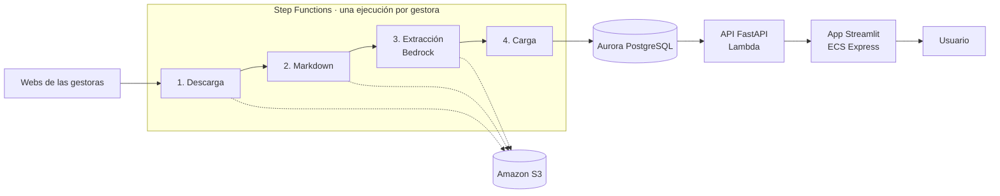
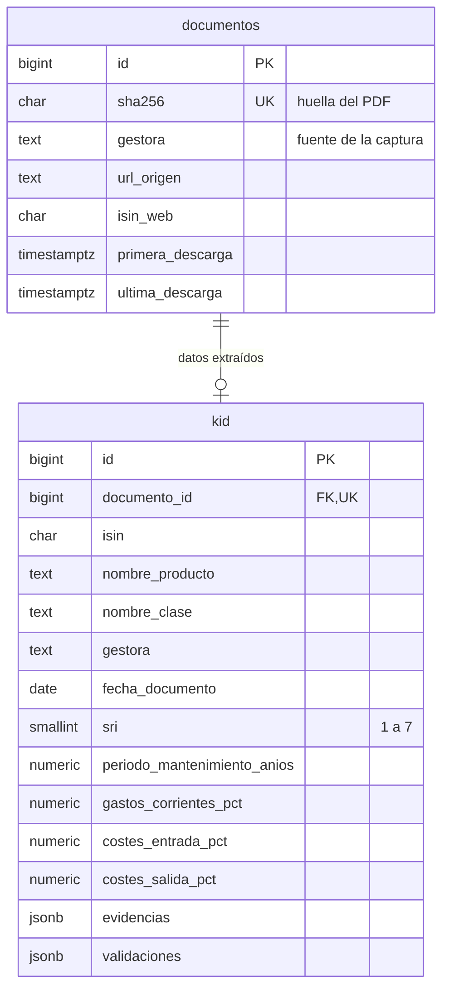
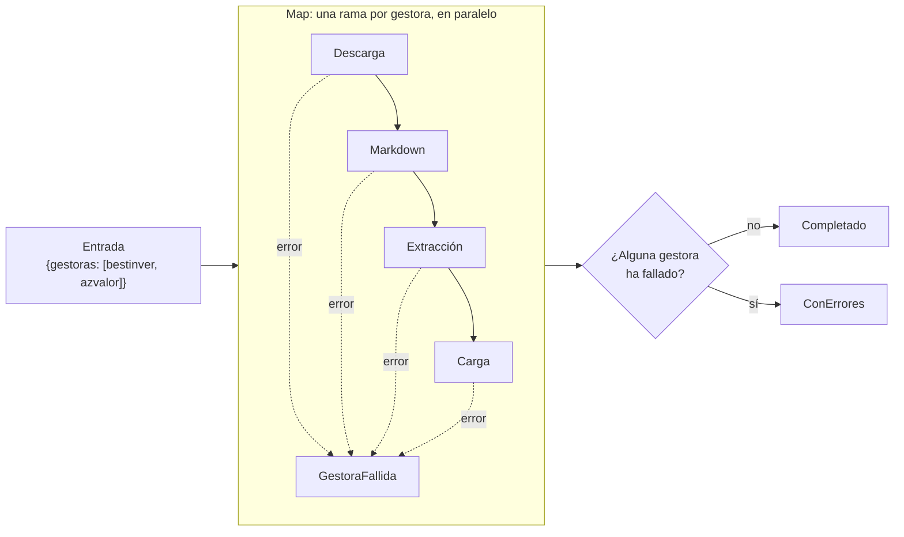

# pipeline-kid-fondos

Pipeline de datos de fondos de inversión en AWS: captura de los KID (Documento de Datos Fundamentales) publicados por las gestoras, extracción de sus datos con IA generativa en Amazon Bedrock, carga en PostgreSQL y explotación mediante una API y una aplicación web.

Toda la infraestructura se define con Terraform y se despliega desde GitHub Actions.

## Arquitectura



| Capa | Servicio | Papel |
|---|---|---|
| Captura | Lambda (requests + lxml) | Descarga los KID de Bestinver y Azvalor y registra su origen en un manifiesto |
| Almacenamiento | Amazon S3 | PDF, Markdown y JSON extraídos, por gestora y fecha |
| Extracción | Lambda + Amazon Bedrock | Convierte el PDF a Markdown y extrae los campos con salida estructurada (JSON Schema) |
| Base de datos | Aurora PostgreSQL Serverless v2 + RDS Data API | Datos de cada KID, sin duplicados |
| API | FastAPI en Lambda (Function URL) | Acceso HTTP a los datos |
| Aplicación | Streamlit en ECS Express Mode | Exploración visual de los fondos |
| Despliegue | Terraform + GitHub Actions (OIDC) | Infraestructura como código, sin credenciales guardadas |

## Decisiones de diseño

**Pipeline en cuatro etapas encadenadas.** Descarga, conversión a Markdown, extracción y carga son funciones Lambda independientes (imágenes Docker) que Step Functions ejecuta en serie para cada gestora. Cada etapa deja su resultado en S3 y devuelve la lista de ficheros que la siguiente debe procesar. Frente a una única función que hiciera todo, permite repetir solo la etapa que falla, mantiene imágenes ligeras (el OCR y el LLM no conviven) y deja registro de cada ejecución.

**Fuentes y alcance.** Bestinver y Azvalor, solo documentos KID. Se extraen los campos mínimos del Anexo A del enunciado.

**Trazabilidad de la captura.** Cada ejecución guarda un `manifiesto.json` con, por documento: URL de origen, fecha y hora de descarga (UTC), huella `sha256` y tamaño. La huella identifica un mismo PDF aunque se descargue varias veces.

**Extracción con salida estructurada.** El modelo (Kimi K3.1 en Bedrock) recibe un JSON Schema mediante `outputConfig.textFormat` de la Converse API, de modo que la respuesta cumple el esquema por construcción. Cada campo va acompañado de su evidencia literal en el documento, que se verifica después: es el control de que el modelo no inventa valores. Un campo que no aparece en el KID queda vacío (null).

**Base de datos sin duplicados.** Dos tablas: `documentos` (un PDF por fila, única por `sha256`) y `kid` (los campos extraídos, enlazados a su documento). Procesar dos veces el mismo PDF no crea filas nuevas; una versión nueva de un KID se conserva como histórico y una vista ofrece la última versión de cada ISIN.

**Aurora Serverless v2 con Data API.** Con un mínimo de 0 ACU la base de datos se pausa cuando no se usa y en reposo solo cuesta el almacenamiento. La Data API permite consultarla por HTTPS con el rol de IAM de cada Lambda, sin conectarla a la VPC ni gestionar contraseñas (las guarda AWS en Secrets Manager).

**Explotación.** La API (FastAPI en Lambda con Function URL) es la única puerta a los datos; la aplicación Streamlit la consume en lugar de leer la base de datos directamente.

**Despliegue.** GitHub Actions se autentica en AWS por OIDC: no hay claves de acceso guardadas en ningún sitio. El rol de despliegue tiene permisos de administrador por simplicidad, acotados por su política de confianza a la rama `main` de este repositorio. Los nombres que deben ser únicos en AWS (buckets) llevan un sufijo derivado de un hash de la cuenta, sin exponer su identificador.

## Estructura del repositorio

```
infra/bootstrap/        arranque de la cuenta (una vez): estado de Terraform y conexión GitHub–AWS
infra/                  infraestructura base: bucket de datos, repositorios de imágenes (ECR) y Aurora
infra/servicios/        servicios que usan esa base: funciones Lambda de las etapas, orquestación, API y app
common/                 código compartido por las etapas (acceso a S3, eventos de Lambda)
webscrapper/            etapa 1: captura de los KID (un módulo por gestora)
pdf_markdown/           etapa 2: PDF a Markdown
structured_output/      etapa 3: extracción con Bedrock
carga/                  etapa 4: carga en PostgreSQL
api/                    API HTTP
app/                    aplicación web
tests/                  tests unitarios (pytest), sin acceso a internet ni a AWS
.github/workflows/      despliegue y ejecución con GitHub Actions
```

## Captura de los KID (etapa 1)

| Gestora | Listado de fondos | Dónde está el KID |
|---|---|---|
| Bestinver | Pie de página de `/fondos-de-inversion/` | Enlace «Datos fundamentales» de cada ficha |
| Azvalor | Enlaces a `/fondos-de-inversion/<slug>/` en `/fondos/` | Enlace «Folleto simplificado (DFP)» de cada ficha; el nombre del PDF incluye su fecha, por lo que la URL se lee del HTML en cada ejecución |

Cada gestora tiene su módulo (`webscrapper/gestora_<nombre>.py`) con una única función, `localizar_kids`, que devuelve los KID publicados en la web. La lógica común está en `webscrapper/captura.py`: descarga cada PDF, comprueba que es un PDF, calcula su huella `sha256`, lo sube a `download/<gestora>/<AAAAMMDD>/<slug>_datos_fundamentales.pdf` y guarda el manifiesto de la ejecución en `download/<gestora>/<AAAAMMDD>/manifiesto.json`:

```json
{
  "gestora": "azvalor",
  "fecha": "20261127",
  "inicio": "2026-11-27T16:29:23Z",
  "fin": "2026-11-27T16:29:34Z",
  "documentos": [{
    "fondo": "Azvalor Internacional FI",
    "slug": "azvalor-internacional",
    "url_ficha": "https://www.azvalor.com/fondos-de-inversion/azvalor-internacional/",
    "url_origen": "https://www.azvalor.com/wp-content/uploads/2026/01/DFP-Internacional-09.01.2026.pdf",
    "isin_web": "ES0112611001",
    "clave_s3": "download/azvalor/20261127/azvalor-internacional_datos_fundamentales.pdf",
    "fecha_descarga": "2026-11-27T16:29:30Z",
    "sha256": "16711022b3ec1e1b889cddc1b748c9afdcb9b9e5821d5a241d98296d9a104fd9",
    "tamano_bytes": 436559
  }, …],
  "incidencias": [],
  "fallos": []
}
```

- **Captura responsable.** Antes de cada petición se comprueban las reglas de `robots.txt` del sitio (incluidos los comodines `*` y `$`), se deja una pausa entre peticiones (1 s por defecto) y solo se descargan documentos regulatorios públicos, unos 30 por ejecución. Los PDF no se exponen: el bucket es privado. El `robots.txt` de Bestinver contiene `Disallow: /*.pdf$`, una regla orientada a que los buscadores no indexen sus PDF; los enlaces que la web publica para los KID llevan un parámetro (`…pdf?h=…`) y no coinciden con ella.
- **Cambios en las webs.** Si un selector deja de encontrar elementos se usa uno más general y se avisa en el log; las fichas sin KID quedan registradas como incidencias, y si no se guarda ningún KID la etapa falla. Ha ocurrido ya: la lista de documentos de las fichas de Bestinver no coincide con el XPath original y la captura funciona con el selector de respaldo.
- **ISIN de la web.** Cuando la ficha publica un único ISIN válido (con dígito de control correcto) se guarda en el manifiesto, para contrastarlo después con el que extrae el modelo.

Ejecución en local: `python webscrapper/captura.py <gestora>` (con la variable `BUCKET_DATOS`), o `--localizar` para listar los KID sin descargarlos.

## Extracción de los datos (etapas 2 y 3)

**Etapa 2: PDF a Markdown** (`pdf_markdown/`). Cada KID se convierte a Markdown con `pymupdf4llm`, que conserva títulos, listas y tablas (las de costes salen como tablas Markdown) y aplica OCR con RapidOCR solo en las páginas que lo necesitan. Un texto limpio y estructurado es mejor entrada para el modelo que el PDF en bruto.

**Etapa 3: extracción con Bedrock** (`structured_output/`). El modelo (por defecto, Kimi K3.1 mediante el perfil de inferencia global) recibe el Markdown y devuelve los campos del Anexo A con **salida estructurada**: el esquema JSON del modelo `DatosKID` (Pydantic) se envía en `outputConfig.textFormat` de la Converse API, así que la respuesta cumple el esquema por construcción. El esquema respeta los límites de Bedrock para salidas estructuradas: todos los campos son obligatorios en el esquema y los que pueden faltar admiten `null` (como máximo 16 campos con tipo unión), y no usa restricciones numéricas, que Bedrock no admite; los rangos se comprueban después. Un test lo verifica.

Cada campo va acompañado de su **evidencia**, el fragmento literal del documento del que sale. Después de la extracción se comprueba:

| Control | Qué detecta |
|---|---|
| La evidencia aparece en el texto (ignorando la marca Markdown y los espacios) | Valores que el modelo no ha leído del documento |
| Dígito de control del ISIN | ISIN mal transcritos |
| ISIN igual al publicado en la ficha web (manifiesto) | KID descargado de la ficha equivocada o ISIN de otra clase |
| SRI entre 1 y 7 | Valores fuera de escala |

El JSON de cada KID (`extraction/<gestora>/<AAAAMMDD>/<slug>_datos_fundamentales.json`) incluye los datos, las evidencias, el resultado de estos controles y los datos de origen del manifiesto (URL, fecha de descarga y huella del PDF), que la etapa 4 usa para cargar la base de datos. La extracción procesa varios KID en paralelo (4 por defecto).

Ejecución en local: `python pdf_markdown/pdf_a_markdown.py <gestora>` y `python structured_output/extractor_kid.py <gestora>`.

## Base de datos (etapa 4)

La etapa 4 (`carga/`) lee los JSON de `extraction/` y los carga en Aurora PostgreSQL mediante la RDS Data API. Antes de cargar aplica `carga/esquema.sql`, cuyas sentencias son idempotentes, así que la base de datos no necesita preparación manual.



- **`documentos`**: un PDF por fila, único por su `sha256`. Si una ejecución vuelve a descargar el mismo PDF, solo se actualiza `ultima_descarga`.
- **`kid`**: los campos del Anexo A de cada documento (único por documento), con el modelo usado, las evidencias, su verificación y las validaciones en columnas JSONB. Reprocesar un documento actualiza su fila.
- **`kid_actual`** (vista): la versión más reciente de cada ISIN, que es la que consultan la API y la aplicación. Si la gestora publica un KID nuevo (otro PDF, otra huella), el anterior se conserva como histórico.

Cada documento se carga en una transacción (documento y datos a la vez). La función devuelve el número de filas antes y después de la carga: procesar dos veces los mismos documentos deja los recuentos igual.

## Orquestación y ejecución programada

Las cuatro etapas se encadenan con una máquina de estados de **Step Functions** (`pipeline-kid-pipeline`), definida en `infra/servicios/orquestacion.tf`:



- La respuesta de cada función es la entrada de la siguiente (`OutputPath: $.Payload`).
- Los errores transitorios del servicio Lambda se reintentan (3 intentos con espera creciente).
- Si una etapa falla, esa gestora termina en `GestoraFallida` con el detalle del error y las demás continúan. Al final, la ejecución termina en error si alguna gestora ha fallado, para que se vea en la consola.
- Cada ejecución queda registrada y se puede seguir paso a paso en la consola de Step Functions.

**Ejecución programada.** Un horario de **EventBridge Scheduler** inicia el pipeline para todas las gestoras el **día 15 de cada mes a las 9:00 (hora de Madrid)**: los KID se actualizan con poca frecuencia. Se desactiva con la variable `horario_activo` de `infra/servicios`.

**Ejecución manual.** Workflow **Ejecutar pipeline** (pestaña *Actions → Run workflow*): inicia una ejecución para una gestora o para todas, espera a que termine y muestra el resumen de la carga y el contenido de la base de datos.

## Despliegue

Región: `eu-west-3` (París). La cuenta de AWS debe estar en el plan de pago: el plan gratuito solo permite crear Aurora con la configuración express, que no admite la Data API con las credenciales gestionadas ni la creación directa desde Terraform. El gasto se cubre con los créditos de la cuenta y se vigila con alertas de AWS Budgets.

### 1. Arranque de la cuenta (una sola vez)

En AWS CloudShell, con un usuario administrador:

```bash
git clone https://github.com/eglezarr/pipeline-kid-fondos.git
bash pipeline-kid-fondos/infra/bootstrap/arrancar.sh
```

El script instala Terraform si hace falta, crea el bucket privado del estado de Terraform y aplica `infra/bootstrap/`: el proveedor OIDC de GitHub y el rol `pipeline-kid-github-deploy`. Al terminar muestra el ARN del rol.

### 2. Secreto en GitHub

En el repositorio: *Settings → Secrets and variables → Actions → New repository secret*, con nombre `AWS_ROLE_ARN` y el ARN del paso anterior.

### 3. Infraestructura base

El workflow **Infraestructura (Terraform)** aplica `infra/` en cada push a `main` que la modifique, o a mano desde la pestaña *Actions*. Al terminar comprueba que la base de datos responde a través de la Data API.

### 4. Imágenes y servicios

El workflow **Despliegue (imágenes y servicios)** se ejecuta en cada push a `main` que modifique el código o `infra/servicios/`:

1. Pasa el linter (`ruff`) y los tests (`pytest`); si fallan, no se despliega nada.
2. Construye y sube a ECR la imagen de cada etapa cuya carpeta ha cambiado (todas si cambia `common/`).
3. Aplica `infra/servicios/`: cada función Lambda pasa a usar la imagen más reciente de su repositorio.
