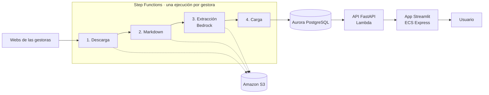

# pipeline-kid-fondos

Pipeline de datos de fondos de inversión en AWS: captura de los KID (Documento de Datos Fundamentales) publicados por las gestoras, extracción de sus datos con IA generativa en Amazon Bedrock, carga en PostgreSQL y explotación mediante una API y una aplicación web.

Toda la infraestructura se define con Terraform y se despliega desde GitHub Actions.

## Arquitectura



| Capa | Servicio | Papel |
|---|---|---|
| Captura | Lambda (requests + lxml) | Descarga los KID de Bestinver y Azvalor y registra su origen en un manifiesto |
| Almacenamiento | Amazon S3 | PDF, Markdown y JSON extraídos, por gestora y fecha |
| Extracción | Lambda + Amazon Bedrock | Convierte el PDF a Markdown y extrae los campos con salida estructurada (JSON Schema) |
| Base de datos | Aurora PostgreSQL Serverless v2 + RDS Data API | Datos de cada KID, sin duplicados |
| API | FastAPI en Lambda (Function URL) | Acceso HTTP a los datos |
| Aplicación | Streamlit en ECS Express Mode | Exploración visual de los fondos |
| Despliegue | Terraform + GitHub Actions (OIDC) | Infraestructura como código, sin credenciales guardadas |

## Decisiones de diseño

**Pipeline en cuatro etapas encadenadas.** Descarga, conversión a Markdown, extracción y carga son funciones Lambda independientes (imágenes Docker) que Step Functions ejecuta en serie para cada gestora. Cada etapa deja su resultado en S3 y devuelve la lista de ficheros que la siguiente debe procesar. Frente a una única función que hiciera todo, permite repetir solo la etapa que falla, mantiene imágenes ligeras (el OCR y el LLM no conviven) y deja registro de cada ejecución.

**Fuentes y alcance.** Bestinver y Azvalor, solo documentos KID. Se extraen los campos mínimos del Anexo A del enunciado.

**Trazabilidad de la captura.** Cada ejecución guarda un `manifiesto.json` con, por documento: URL de origen, fecha y hora de descarga (UTC), huella `sha256` y tamaño. La huella identifica un mismo PDF aunque se descargue varias veces.

**Extracción con salida estructurada.** El modelo (Kimi K3.1 en Bedrock) recibe un JSON Schema mediante `outputConfig.textFormat` de la Converse API, de modo que la respuesta cumple el esquema por construcción. Cada campo va acompañado de su evidencia literal en el documento, que se verifica después: es el control de que el modelo no inventa valores. Un campo que no aparece en el KID queda vacío (null).

**Base de datos sin duplicados.** Dos tablas: `documentos` (un PDF por fila, única por `sha256`) y `kid` (los campos extraídos, enlazados a su documento). Procesar dos veces el mismo PDF no crea filas nuevas; una versión nueva de un KID se conserva como histórico y una vista ofrece la última versión de cada ISIN.

**Aurora Serverless v2 con Data API.** Con un mínimo de 0 ACU la base de datos se pausa cuando no se usa y en reposo solo cuesta el almacenamiento. La Data API permite consultarla por HTTPS con el rol de IAM de cada Lambda, sin conectarla a la VPC ni gestionar contraseñas (las guarda AWS en Secrets Manager).

**Explotación.** La API (FastAPI en Lambda con Function URL) es la única puerta a los datos; la aplicación Streamlit la consume en lugar de leer la base de datos directamente.

**Despliegue.** GitHub Actions se autentica en AWS por OIDC: no hay claves de acceso guardadas en ningún sitio. El rol de despliegue tiene permisos de administrador por simplicidad, acotados por su política de confianza a la rama `main` de este repositorio. Los nombres que deben ser únicos en AWS (buckets) llevan un sufijo derivado de un hash de la cuenta, sin exponer su identificador.

## Estructura del repositorio

```
infra/bootstrap/        arranque de la cuenta (una vez): estado de Terraform y conexión GitHub–AWS
infra/                  infraestructura principal (S3, ECR, Aurora, Lambdas, Step Functions, API, app)
common/                 código compartido por las etapas (acceso a S3, eventos de Lambda)
webscrapper/            etapa 1: descarga de los KID
pdf_markdown/           etapa 2: PDF a Markdown
structured_output/      etapa 3: extracción con Bedrock
carga/                  etapa 4: carga en PostgreSQL
api/                    API HTTP
app/                    aplicación web
.github/workflows/      despliegue con GitHub Actions
```

## Despliegue

Región: `eu-west-3` (París). La cuenta de AWS debe estar en el plan de pago: el plan gratuito solo permite crear Aurora con la configuración express, que no admite la Data API con las credenciales gestionadas ni la creación directa desde Terraform. El gasto se cubre con los créditos de la cuenta y se vigila con alertas de AWS Budgets.

### 1. Arranque de la cuenta (una sola vez)

En AWS CloudShell, con un usuario administrador:

```bash
git clone https://github.com/eglezarr/pipeline-kid-fondos.git
bash pipeline-kid-fondos/infra/bootstrap/arrancar.sh
```

El script instala Terraform si hace falta, crea el bucket privado del estado de Terraform y aplica `infra/bootstrap/`: el proveedor OIDC de GitHub y el rol `pipeline-kid-github-deploy`. Al terminar muestra el ARN del rol.

### 2. Secreto en GitHub

En el repositorio: *Settings → Secrets and variables → Actions → New repository secret*, con nombre `AWS_ROLE_ARN` y el ARN del paso anterior.

### 3. Infraestructura

El workflow `Infraestructura (Terraform)` aplica `infra/` en cada push a `main` que la modifique, o a mano desde la pestaña *Actions*.
